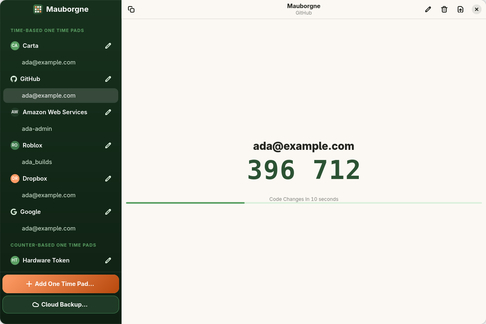

<p align="center">
  
</p>

<p align="center">
  <b>For Linux Desktops</b><br>
  The free and open source Linux desktop client: TOTP and HOTP codes for GNOME, kept in your keyring,
  with optional encrypted Cloud Backup. (Mauborgne for Windows and Android are separate apps.)
</p>

<p align="center">
  
</p>

## Features

* **TOTP and HOTP codes** with SHA-1, SHA-256 and SHA-512, shown large with a countdown, one click to copy
* **Secrets in your keyring**: pad secrets are stored with libsecret (the Flatpak secrets portal in the sandbox), never in plain files
* **Add pads** from a QR code image, a setup key, or an Aegis vault
* **Export** a pad as a QR code, or any or all pads as an encrypted Aegis vault
* **Cloud Backup** (optional, $10 per year; the app itself is free): end to end encrypted backup and automatic sync with the Mauborgne apps for Windows and Android. Your cloud password never leaves your device
* **Sandboxed**: runs as a Flatpak with only the access it needs

## Installing

Mauborgne is distributed as a Flatpak from its own repository: the application is stored as OCI images in
the GitHub Container Registry and a small index is served from GitHub Pages (published with
[AetherPak](https://github.com/aetherpak/actions)). Add the remote once, then install:

```bash
flatpak remote-add --user \
  --signature-lookaside=https://jhaygood86.github.io/mauborgne/sigs \
  mauborgne https://jhaygood86.github.io/mauborgne/mauborgne.flatpakrepo
flatpak install --user mauborgne io.github.jhaygood86.mauborgne
```

The images are signed (Flatpak 1.17 or newer verifies them). The signing key is `Mauborgne Releases <jhaygood86@gmail.com>`, fingerprint `F6B4 229E 4C6C 38FE B2D4  78E3 316E 5078 B7B3 5D08`. With an older Flatpak, add the remote without verification instead:

```bash
flatpak remote-add --if-not-exists --user --no-gpg-verify mauborgne oci+https://jhaygood86.github.io/mauborgne
```

`stable` follows the tagged releases and `beta` follows `main`; choose a channel with
`io.github.jhaygood86.mauborgne//beta`. The GNOME runtime is pulled from Flathub, so that remote needs to be
configured too.

## Building and Installation

You'll need the following dependencies:

* gobject-2.0 >= 2.66
* gtk4
* libadwaita-1 >= 1.5
* libportal-gtk4
* libsoup-3.0
* webkitgtk-6.0
* cotp
* libsecret-1
* gee-0.8
* json-glib-1.0
* libgcrypt
* cargo (optional, for Cloud Backup's OPAQUE client; without it Cloud Backup is unavailable)

Run `meson setup build` to configure the build environment. Change to the build directory and run `ninja` to build

```bash
meson setup build --prefix=/usr
cd build
ninja
```

To install, use `ninja install`, then execute with `io.github.jhaygood86.mauborgne`

You can also build and run with flatpak, which already has all of its dependencies defined as well

```bash
flatpak-builder build  io.github.jhaygood86.mauborgne.yml --user --install --force-clean
flatpak run io.github.jhaygood86.mauborgne
```

Run the tests with `meson test -C build`. A few of them need a Secret Service and are skipped unless
`MAURBORGNE_TEST_SECRET_SERVICE=1` is set.

## Translations

Translations use Weblate. Contribute at https://hosted.weblate.org/projects/maurbogne/

## Special Thanks

Mauborgne utilizes the following open source software that we would like to thank!

 * **[libcotp](https://github.com/paolostivanin/libcotp)** We utilize libcotp for generating the OTP tokens
 * **[quirc](https://github.com/dlbeer/quirc/)** We utilize quirc for parsing QR Codes
 * **[QR Code generator](https://github.com/nayuki/QR-Code-generator)** We utilize Nayuki's library for creating QR Codes
 * **[opaque-ke](https://github.com/facebook/opaque-ke)** The OPAQUE protocol implementation behind Cloud Backup's password handling
 * **[GNOME](https://www.gnome.org)** We are built on the GNOME platform: GLib, GTK 4, libadwaita and WebKitGTK
 * **[flatpak](https://www.flatpak.org)** The future of app distribution. We also utilize their libportal for desktop portals

## License

Mauborgne is licensed under the GNU General Public License, version 3 or later (see `LICENSE`).

The one exception is `subprojects/opaque-bridge`, the OPAQUE client used by Cloud Backup, which is dual licensed
under `GPL-3.0-or-later` or a commercial license (see `subprojects/opaque-bridge/LICENSE.md`).
